<div align="center">
  

  **A unified pipeline for efficient and effective coding harnesses.**

  One tool, no config — works the moment it lands.

  [](https://github.com/HoangP8/tokless/releases)
  [](https://github.com/HoangP8/tokless)
  [](https://github.com/HoangP8/tokless/blob/main/LICENSE)

  <br />

  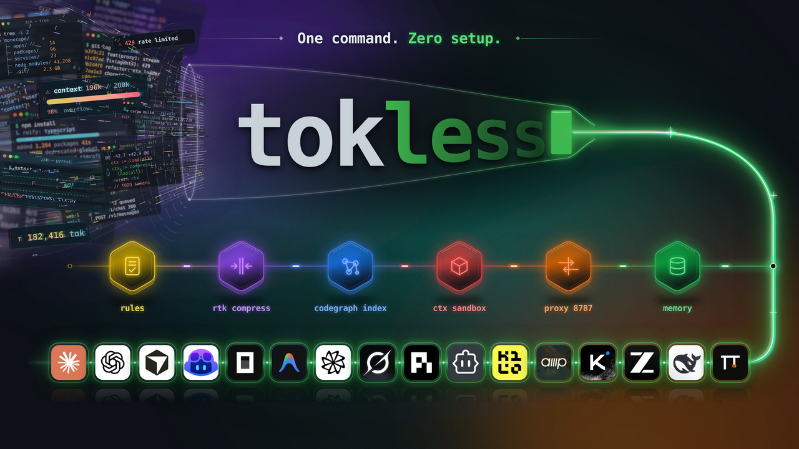

</div>

## Introduction

> *Many packages help coding harnesses work more effectively and efficiently. **The best tools already exist; wiring them well is the real work.** Tokless brings together [specialized tools](#tools), each with a distinct purpose, and manages them with minimal setup.*

<table>
  <tr><td>✅</td><td><b>Clear purpose</b> — best tool for each job, wired without conflict</td></tr>
  <tr><td>✅</td><td><b>No overload</b> — minimal MCP tools with clear, unified instructions</td></tr>
  <tr><td>✅</td><td><b>Zero config</b> — works as soon as installed, in under 30 seconds</td></tr>
  <tr><td>✅</td><td><b>One place</b> — install, update, and manage all tools across every configured harness</td></tr>
</table>

## Supported Harnesses

<div align="center">
  <table>
    <tr>
      <td align="center" width="140"><a href="https://github.com/anthropics/claude-code">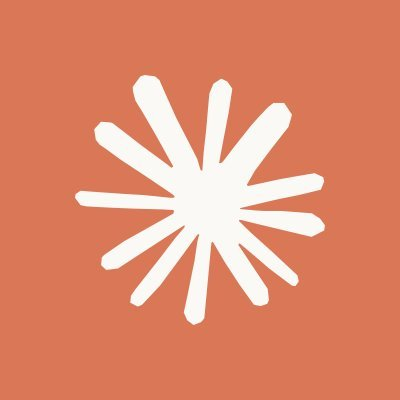</a><br/><b>Claude Code</b><br/></td>
      <td align="center" width="140"><a href="https://github.com/anomalyco/opencode">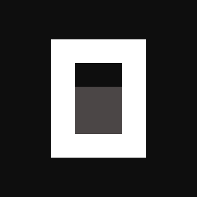</a><br/><b>OpenCode</b><br/></td>
      <td align="center" width="140"><a href="https://github.com/openai/codex">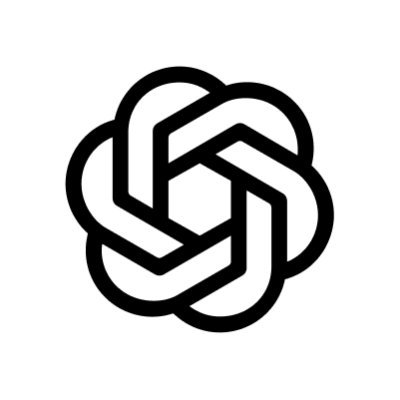</a><br/><b>Codex</b><br/></td>
      <td align="center" width="140"><a href="https://antigravity.google">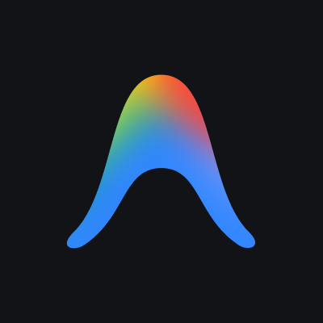</a><br/><b>Antigravity</b><br/></td>
      <td align="center" width="140"><a href="https://github.com/github/copilot-cli">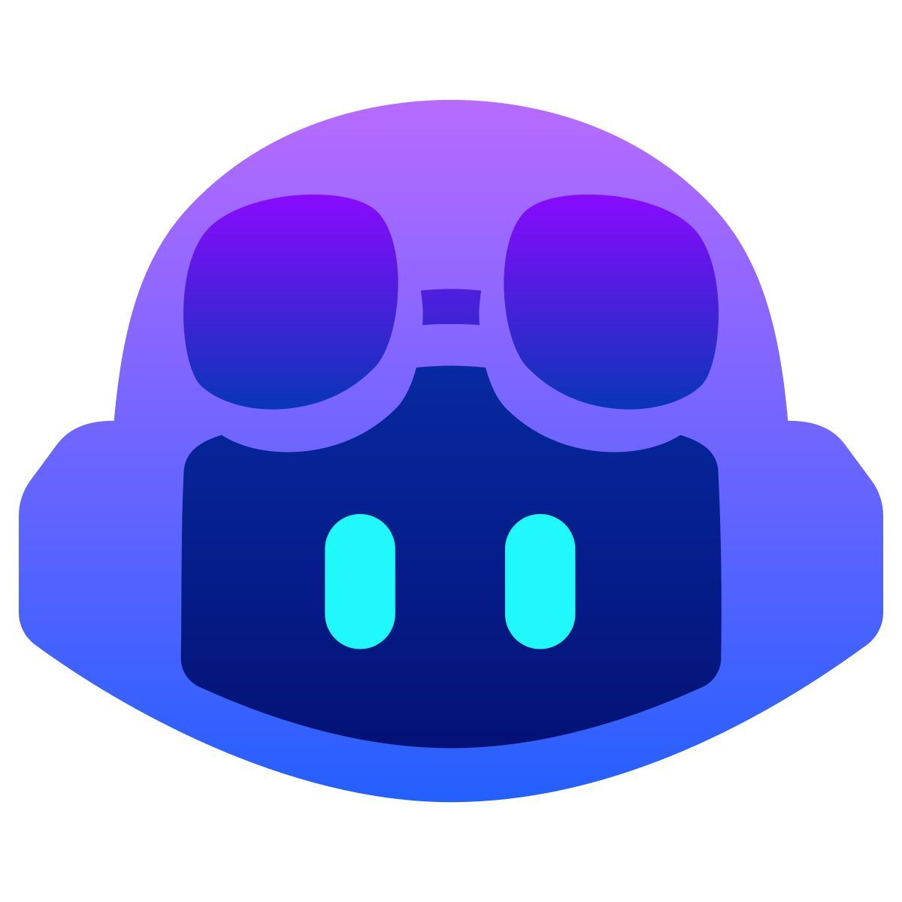</a><br/><b>GitHub Copilot</b><br/></td>
      <td align="center" width="140"><a href="https://factory.ai">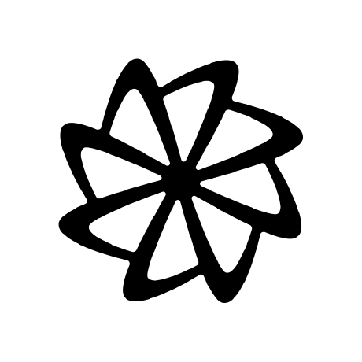</a><br/><b>Factory Droid</b><br/></td>
    </tr>
    <tr>
      <td align="center" width="140"><a href="https://github.com/badlogic/pi-mono">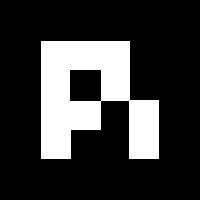</a><br/><b>Pi</b><br/></td>
      <td align="center" width="140"><a href="https://github.com/can1357/oh-my-pi">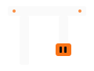</a><br/><b>Oh My Pi</b><br/></td>
      <td align="center" width="140"><a href="https://cline.bot/"></a><br/><b>Cline</b><br/></td>
      <td align="center" width="140"><a href="https://cursor.com">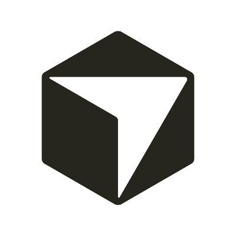</a><br/><b>Cursor</b><br/></td>
      <td align="center" width="140"><a href="https://x.ai/cli"><picture><source media="(prefers-color-scheme: dark)" srcset="assets/agents/grok-dark.png" /><source media="(prefers-color-scheme: light)" srcset="assets/agents/grok-light.png" />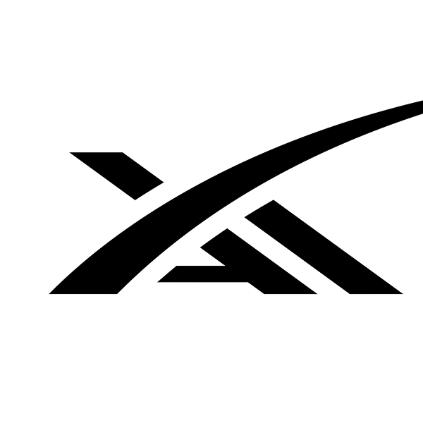</picture></a><br/><b>Grok Build</b><br/></td>
      <td align="center" width="140"><a href="https://kilo.ai/cli">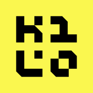</a><br/><b>Kilo Code</b><br/></td>
    </tr>
    <tr>
      <td align="center" width="140"><a href="https://ampcode.com/">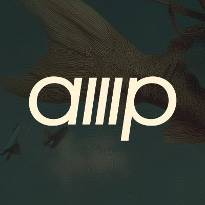</a><br/><b>Amp</b><br/></td>
      <td align="center" width="140"><a href="https://github.com/MoonshotAI/kimi-code">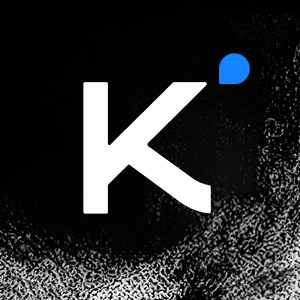</a><br/><b>Kimi Code</b><br/></td>
      <td align="center" width="140"><a href="https://github.com/zai-org/ZCode">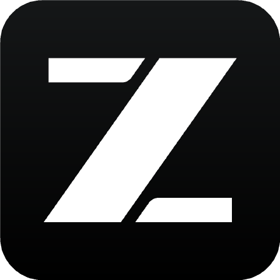</a><br/><b>ZCode</b><br/></td>
      <td align="center" width="140"><a href="https://github.com/deepseek-ai/deepseek-harness">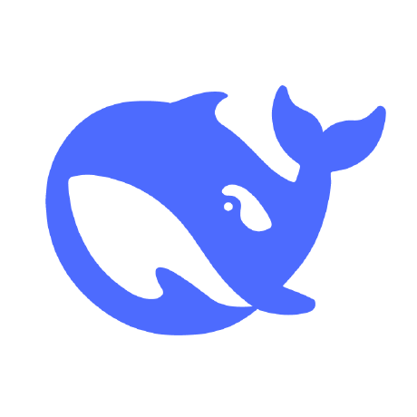</a><br/><b>DeepSeek</b><br/></td>
    </tr>
  </table>
</div>

## Installation

### Manual

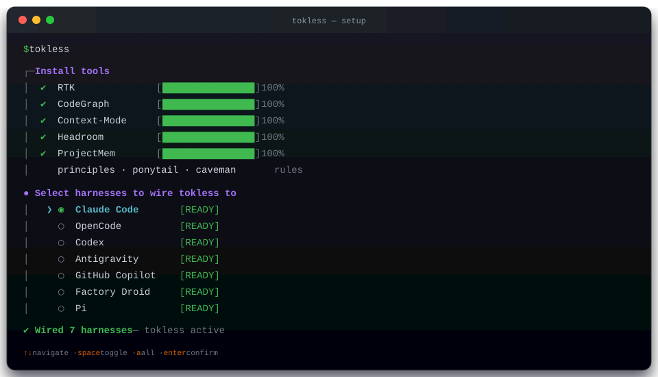

**macOS / Linux**

```bash
curl -fsSL https://raw.githubusercontent.com/HoangP8/tokless/main/scripts/install.sh | bash
```

**Windows (PowerShell)**

```powershell
irm https://raw.githubusercontent.com/HoangP8/tokless/main/scripts/install.ps1 | iex
```

Interactive install detects installed harnesses. First pick tools, then pick harnesses:

```bash
tokless                              # interactive: choose tools, then harnesses
tokless --agents claude,opencode     # wire just these harnesses
tokless --tools rtk,codegraph        # wire just these tools
```

### Copy this for your harness

```text
https://raw.githubusercontent.com/HoangP8/tokless/main/docs/installation.md
```

## Tools

8 packages with distinct roles, wired without conflicts. Ranked by GitHub stars.

| Package | ⭐ | Purpose |
| :--- | :---: | :--- |
| [principles](https://github.com/multica-ai/andrej-karpathy-skills) |  | Karpathy coding rules: think first, simplify, edit surgically, verify. |
| [ponytail](https://github.com/DietrichGebert/ponytail) |  | Minimal-code rules: reuse first, avoid speculative work. |
| [caveman](https://github.com/JuliusBrussee/caveman) |  | Terse response rules that preserve technical accuracy. |
| [rtk](https://github.com/rtk-ai/rtk) |  | Rewrites and compresses command output before it reaches the harness. |
| [headroom](https://github.com/headroomlabs-ai/headroom) |  | Local HTTP proxy that compresses large prompts and routes BYOK model traffic. |
| [codegraph](https://github.com/colbymchenry/codegraph) |  | Indexed code graph for source, call paths, and impact. |
| [context-mode](https://github.com/mksglu/context-mode) |  | Sandboxed context tools with session memory and focused analysis. |
| [projectmem](https://github.com/riponcm/projectmem) |  | Per-project memory: issues, attempts, fixes, decisions, auto-captured from git. |

### MCP tools

Three tools run as MCP servers. Headroom and rtk wire through their own mechanisms (proxy, hooks, plugins) — no MCP needed.

Upstream those three expose **29 tools**. Tokless spawns each server through a bounded proxy that filters its tool list, so **12 land in your context — 17 are trimmed automatically**, at install, nothing to configure.

```text
MCP Tools
├── CodeGraph · 1/1
│   └── codegraph_explore
├── Context Mode · 6/11
│   ├── ctx_execute
│   ├── ctx_batch_execute
│   ├── ctx_execute_file
│   ├── ctx_index
│   ├── ctx_search
│   └── ctx_fetch_and_index
└── ProjectMem · 5/17
    ├── log_issue
    ├── record_attempt
    ├── record_fix
    ├── add_decision
    └── add_note
```

### What gets trimmed

| Server | Upstream | Kept | Trimmed | Why |
| :--- | :---: | :--- | :--- | :--- |
| CodeGraph | 1 | ✅ 1 | — | one tool, nothing to cut |
| Context Mode | 11 | ✅ 6 | ❌ `ctx_stats` · `ctx_doctor` · `ctx_upgrade` · `ctx_insight` · `ctx_purge` | diagnostics and package maintenance — not part of a coding turn |
| ProjectMem | 17 | ✅ 5 | ❌ `current_project` · `get_context` · `get_global_gotchas` · `get_instructions` · `get_issue` · `get_plan` · `get_project_map` · `get_score` · `get_summary` · `list_projects` · `precheck_file` · `search_events` | its reads arrive before the first prompt |

**ProjectMem is the case that matters.** Its 12 read tools (`get_summary`, `get_plan`, …) are replaced by a memory block pushed at session start — hook, plugin/extension, or rule file depending on the harness. Nothing to call: only the 5 writers stay on the list. `tokless doctor` reports the exposed set.

## Usage

```bash
tokless                           # install + wire everything (safe to re-run)
tokless --agents claude,codex     # wire only these harnesses
tokless --tools rtk,codegraph     # wire only these tools
tokless --dry-run                 # preview every write, change nothing

tokless update                    # upgrade CLI + all tools
tokless self-update               # upgrade the tokless binary only
tokless doctor                    # health: tools, harnesses, routes
tokless doctor --fix              # start proxy / build index, interactively
tokless info                      # install paths, config locations
tokless index                     # build this project's codegraph index

tokless disable --agents claude   # unwire harnesses (keep installed tools)
tokless disable --uninstall       # unwire + remove installed binaries
tokless uninstall                 # same as disable --uninstall
tokless proxy up | down | status  # headroom proxy (accepts --agents)
```

```text
Harness ids: claude, opencode, opencode2, codex, antigravity, copilot, droid, grok, pi, omp, kilo, cline, cursor, amp, kimi, dsh, zcode
Tool ids: rtk, caveman, ponytail, principles, codegraph, context-mode, headroom, projectmem
```

## Configuration

### How the tools actually work

Wiring is the product: after install, everything runs on its own — no runtime commands from you.

| Tool | How | When |
| :--- | :--- | :--- |
| principles · caveman · ponytail | Instruction block (rules file) | every prompt — always in context |
| rtk | hook · plugin · extension · cordis patch | every Bash command — rewrite + compress output |
| headroom | local HTTP proxy + route in config | every model API call — compress prompts, route BYOK + OAuth |
| codegraph | MCP server (`codegraph_explore`) | on demand; index builds at first connect |
| context-mode | MCP server (`ctx_*`) | on demand — large files / logs stay out of context |
| projectmem | MCP server + context injection | ~2000-token memory block at session start |

```text
INSTALL ─┬─ rules block      principles · caveman · ponytail
         ├─ MCP entries      codegraph · context-mode · projectmem
         ├─ rtk mechanism    hook · plugin · extension · patch
         └─ headroom route   local proxy 127.0.0.1:8787

SESSION ─┬─ codegraph index  built on first connect
         └─ projectmem block injected before the first prompt

WORK ────┬─ prompt → rules + project memory ride along every turn
         ├─ Bash   → rtk rewrites the command and compresses output
         ├─ think  → codegraph_explore: source, callers, blast radius
         ├─ big    → ctx_* keeps large files and logs out of context
         └─ API    → headroom compresses prompts, routes BYOK + Grok OAuth
```

Without tokless, the harness re-reads the raw tree every session, Bash output lands uncompressed, and nothing survives between sessions. Tokless inverts all three: indexed code, compressed commands, persistent memory.

### How tokless connects to harnesses × 8 tools

**Instruction** = markdown block · **Rule** = project rule file · **Hook** = PreToolUse / SessionStart command · **Plugin** = JS/TS plugin · **Extension** = harness extension API · **Patch** = cordis insert (dsh) · **MCP** = Model Context Protocol server.

<table>
  <thead>
    <tr>
      <th align="left" nowrap>Harness</th>
      <th align="center">rules<br/><sub>principles · caveman · ponytail</sub></th>
      <th align="center">rtk</th>
      <th align="center">codegraph</th>
      <th align="center">context-mode</th>
      <th align="center">headroom</th>
      <th align="center">projectmem</th>
    </tr>
  </thead>
  <tbody>
    <tr><td nowrap><b>Claude Code</b></td><td align="center">Instruction</td><td align="center">Hook</td><td align="center">MCP</td><td align="center">MCP</td><td align="center">anthropic-native</td><td align="center">MCP + Hook</td></tr>
    <tr><td nowrap><b>OpenCode</b></td><td align="center">Instruction</td><td align="center">Plugin</td><td align="center">MCP</td><td align="center">MCP</td><td align="center">openai-compatible</td><td align="center">MCP + Plugin</td></tr>
    <tr><td nowrap><b>Codex</b></td><td align="center">Instruction</td><td align="center">Hook</td><td align="center">MCP</td><td align="center">MCP</td><td align="center">openai-compatible</td><td align="center">MCP + Hook</td></tr>
    <tr><td nowrap><b>Antigravity</b></td><td align="center">Instruction</td><td align="center">Hook</td><td align="center">MCP + Hook</td><td align="center">MCP</td><td align="center">gemini-native</td><td align="center">MCP + Hook</td></tr>
    <tr><td nowrap><b>GitHub Copilot</b></td><td align="center">Instruction</td><td align="center">Hook</td><td align="center">MCP + Hook</td><td align="center">MCP</td><td align="center">openai-compatible</td><td align="center">MCP + Hook</td></tr>
    <tr><td nowrap><b>Factory Droid</b></td><td align="center">Instruction</td><td align="center">Hook</td><td align="center">MCP + Hook</td><td align="center">MCP</td><td align="center">openai-compatible</td><td align="center">MCP + Hook</td></tr>
    <tr><td nowrap><b>Pi</b></td><td align="center">Instruction</td><td align="center">Extension</td><td align="center">MCP + Ext</td><td align="center">MCP</td><td align="center">openai-compatible</td><td align="center">MCP + Ext</td></tr>
    <tr><td nowrap><b>Oh My Pi</b></td><td align="center">Instruction</td><td align="center">Extension</td><td align="center">MCP</td><td align="center">MCP</td><td align="center">openai-compatible</td><td align="center">MCP + Ext</td></tr>
    <tr><td nowrap><b>Cline</b></td><td align="center">Instruction</td><td align="center">Hook</td><td align="center">MCP</td><td align="center">MCP</td><td align="center">openai-compatible</td><td align="center">MCP + Rule</td></tr>
    <tr><td nowrap><b>Cursor</b></td><td align="center">Instruction</td><td align="center">Hook</td><td align="center">MCP + Hook</td><td align="center">MCP</td><td align="center">—</td><td align="center">MCP + Rule</td></tr>
    <tr><td nowrap><b>Grok Build</b></td><td align="center">Instruction</td><td align="center">Hook</td><td align="center">MCP + Hook</td><td align="center">MCP</td><td align="center">BYOK + OAuth</td><td align="center">MCP + Rule</td></tr>
    <tr><td nowrap><b>Kilo Code</b></td><td align="center">Instruction</td><td align="center">Plugin</td><td align="center">MCP</td><td align="center">MCP</td><td align="center">openai-compatible</td><td align="center">MCP + Plugin</td></tr>
    <tr><td nowrap><b>Amp</b></td><td align="center">Instruction</td><td align="center">Plugin</td><td align="center">MCP</td><td align="center">MCP</td><td align="center">—</td><td align="center">MCP</td></tr>
    <tr><td nowrap><b>Kimi Code</b></td><td align="center">Instruction</td><td align="center">—</td><td align="center">MCP</td><td align="center">MCP</td><td align="center">openai-compatible</td><td align="center">MCP</td></tr>
    <tr><td nowrap><b>ZCode</b></td><td align="center">Instruction</td><td align="center">Hook</td><td align="center">MCP</td><td align="center">MCP</td><td align="center">openai-compatible</td><td align="center">MCP</td></tr>
    <tr><td nowrap><b>DeepSeek</b></td><td align="center">Instruction</td><td align="center">Patch</td><td align="center">MCP</td><td align="center">MCP</td><td align="center">openai-compatible</td><td align="center">MCP</td></tr>
  </tbody>
</table>

- Kimi Code has no rtk mechanism yet (its CLI exposes no PreToolUse hook) — rtk skipped, all other tools wired.
- Grok is routed, Cursor's route is deprecated, and Amp is never auto-wired — see [Headroom](#headroom--the-local-proxy).

### Per-harness config locations

Where each tool lands. `mcp.json`-style shapes hold MCP server entries; instruction files hold the markdown blocks.

| Harness | MCP / tool config | Instruction file |
| :--- | :--- | :--- |
| Claude Code | `~/.claude.json` (+ `~/.claude/settings.json` for hooks, permissions) | `~/.claude/CLAUDE.md` |
| OpenCode | `~/.config/opencode/opencode.json` (`mcp.*`, plugins) | `~/.config/opencode/AGENTS.md` |
| Codex | `~/.codex/config.toml` (`[mcp_servers.*]`, hooks) | `~/.codex/AGENTS.md` |
| Antigravity | `~/.gemini/antigravity/mcp_config.json` (+ `~/.gemini/settings.json` for hooks) | `~/.gemini/GEMINI.md` |
| GitHub Copilot | `~/.copilot/mcp-config.json` (+ `~/.copilot/settings.json`) | `~/.copilot/copilot-instructions.md` |
| Factory Droid | `~/.factory/mcp.json` (+ `~/.factory/settings.json`) | `~/.factory/AGENTS.md` |
| Pi | `~/.pi/agent/mcp.json` (+ `~/.pi/agent/settings.json`, extensions) | `~/.pi/agent/AGENTS.md` |
| Oh My Pi | `~/.omp/agent/mcp.json` (+ `~/.omp/agent/config.yml`, extensions) | `~/.omp/agent/AGENTS.md` |
| Cline | `~/.cline/data/settings/cline_mcp_settings.json` | `~/.cline/rules/AGENTS.md` |
| Cursor | `~/.cursor/mcp.json` (rules for generated instructions) | `.cursor/rules/` |
| Grok Build | `~/.grok/config.toml` (`[mcp_servers.*]`, hooks) | `~/.grok/rules/AGENTS.md` |
| Kilo Code | `~/.config/kilo/kilo.jsonc` (`mcp.*`) | harness instructions block |
| Amp | `~/.config/amp/settings.json` (`amp.mcpServers.*`) | `~/.config/amp/AGENTS.md` |
| Kimi Code | `~/.kimi-code/mcp.json` (+ `~/.kimi-code/config.toml`) | `~/.kimi-code/AGENTS.md` |
| ZCode | `~/.zcode/cli/config.json` (`mcp.servers.*`, plugin `tokless-mcp`) | `~/.zcode/AGENTS.md` |
| DeepSeek | `~/.dsh/cordis.patch.yml` (`mcp_servers.*` insert rows) | `~/.dsh/AGENTS.md` |

Foreign (non-tokless) entries are never overwritten; tokless verifies its own entries after every write and reports the result in `tokless doctor`.

OpenCode v2 resolves its config dir in this order: `OPENCODE_CONFIG_DIR_V2`, then `~/.config/opencode2` (wrapper convention), then the shared `~/.config/opencode` (plain v2 default). v1 keeps the original shape; v2 entries additionally carry the v2 forms, and unwires are version-scoped.

### Headroom — the local proxy

Headroom is the one tool with no MCP. It is a local HTTP proxy between your harness and the provider: prompts pass through, get compressed, and continue to the original provider. Tokless wires the route at install and starts the daemon.

```text
harness → 127.0.0.1:8787 (Headroom) → provider
```

| Port | Role |
| :--- | :--- |
| `8787` | Main proxy — `anthropic-native` (Claude Code) + `gemini-native` (Antigravity) + `openai-compatible` (Grok BYOK; Copilot reaches it via its `8790` / `8789` wrappers) |
| `18787` | BYOK gateway — named providers (`qwencoder`, `nvidia_nim`, `cliproxyapi`, `cline`) with your own keys |
| `28787` | Grok OAuth — Headroom-owned login proxy |
| `8790` / `8789` | Copilot CLI / VS Code wrappers |

Grok uses Headroom on both paths: its BYOK `base_url` is rewritten to the shared daemon (`8787/v1`), and its OAuth login runs on a Headroom-owned proxy (`28787`). Cursor's proxy route is deprecated and Amp is never auto-wired — those two stay on their native provider.

Manage it with `tokless proxy up | down | status`. `--agents` scopes any of them to one harness, and `down --agents <list>` leaves shared Headroom running for the rest.
